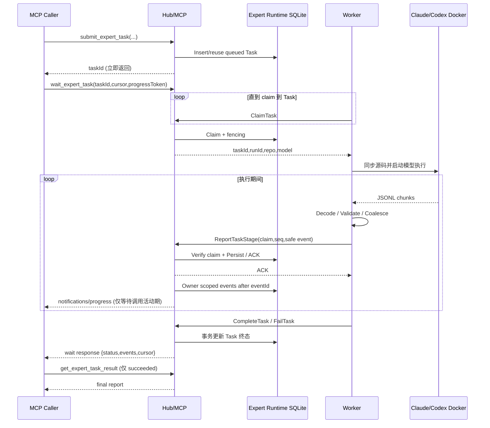

# Expert Platform 工具活动级实时进度详细设计

> 日期：2026-10-28
> 状态：**P1–P5 已编码并通过本地集成测试；P6 真实 Claude CLI/Worker 联调待验收，未提交**
> 范围：Claude Code / Codex CLI 的只读专家任务、Worker→Hub 进度记录、MCP 增量读取与 `wait_expert_task`、Admin 任务详情、验收测试。
> 依赖：现有 Expert Task/Run、Session 同专家串行队列、Worker gRPC、`expert_events`、MCP v2。
> 不包含：原始模型思考流、逐 token 文本、任意工具参数/源码内容上传、全平台 SSE 订阅、替换既有 Task API 或标准 MCP Tasks 迁移。

## 1. 目标与不变量

目标：MCP 调用者能够在任务进行中知道“排队/同步仓库/启动模型/读取搜索源码/生成报告/完成或失败”，可断线恢复，并准确区分 Task、Run、Session。默认展示**工具活动级**进度，而不是 Agent 私有推理或原始日志。

不变量：

1. `submit_expert_task[_auto]` 继续即时返回 `taskId`；执行与等待是两次独立请求。
2. `succeeded/failed/cancelled` 的权威状态仅由原有 Task 完成/失败/取消路径改变，**进度事件不可驱动终态**。
3. 所有进度通过 Hub 现有 Principal / Tenant 权限校验；Worker 事件额外验证 Credential、`taskId/runId/workerId/fencing` 和未过期 Lease。
4. 进度最多一次或至少一次传输都不能改变任务结果；断线重试与去重明确，过期 Run 不能修改当前进度。
5. stdout 处理永不被进度上报阻塞；对原始输出设边界，最终结果独立保留及校验。
6. 不暴露 prompt、模型文本、thinking、完整文件路径、工具参数、工具 stdout/stderr、密钥、Git 认证及第三方 API 原始响应。
7. MCP `notifications/progress` 仅在带 `progressToken` 的**活动 `wait_expert_task` 请求**期间发送；连接中断只结束等待，不取消 Worker Task。
8. `x-skill-hub-session-id` / MCP transport session 只用于排队归属与观测；工具读取以 Task Owner（Principal + Tenant）为准，不以 Session ID 作为授权凭据。

## 2. 已有实现核对（2026-10-28）

| 模块                             | 当前事实                                                                                    | 所需变更                                                                       |
| -------------------------------- | ------------------------------------------------------------------------------------------- | ------------------------------------------------------------------------------ |
| `claude-runtime.ts`              | `-p --output-format json`，完成后解析 `result`                                              | `stream-json --verbose`；增量解析，最终 `result` 严格校验                      |
| `codex-runtime.ts`               | `exec --json`，解析 `turn.completed` / `item.completed`                                     | 保留 JSONL 协议，新增进度事件映射                                              |
| `codex-process.ts`               | 按 chunk 拼接 stdout，退出后解析；累计输出上限                                              | 带行边界的增量 reader、有限缓冲、独立最终结果与回调                            |
| `docker-codex-executor.ts`       | 已上报 repository/container/claude/codex 生命周期阶段；Git 每次 fetch 指定 branch           | 注入事件适配器与缓冲聚合器，不改变 Git 或 Docker 隔离                          |
| `grpc-transport.ts` / proto      | `ReportTaskStage` unary，带 claim 身份与鉴权                                                | P0 复用方法，收窄/扩展事件白名单及可选结构化细节                               |
| `task-store.ts`                  | `expert_events(event_id,task_id,run_id,event_type,details,created_at)`；每 Run 阶段上限 200 | 事件限额分区/终态保留、Owner 游标读取、索引/去重、安全摘要                     |
| `mcp.ts`                         | 提交/状态/结果/取消工具；MCP v2 `registerTool` 包装器                                       | 扩展 Status、`get_expert_task_events`、`wait_expert_task`，向 handler 转发 ctx |
| Admin `/admin/experts#task/{id}` | 10 秒刷新结构化阶段                                                                         | 显示最近活动、时间线、按 Run 区分，不展示原始数据                              |
| Session 队列                     | 同 Session+Expert 的不同任务串行，重复活动任务复用                                          | Queued 阶段和等待原因展示；多 Task 不串事件                                    |

### 2.1 设计取舍

第一版复用 `ReportTaskStage` 和 `expert_events`，**不增加进度事件表、不增加独立 Progress gRPC RPC**。但保留明确升级阈值：若超过当前事件上限、要求无损工具追踪或独立日志保留策略，再引入 `ReportTaskProgress` + 独立表。对原有事件结构做有界的向后兼容迁移，而非存任意 JSON 文本。

## 3. 统一执行事件契约

Worker 内部事件接口：

```ts
type ActivityKind =
  | "repository.started"
  | "repository.completed"
  | "repository.failed"
  | "container.started"
  | "container.completed"
  | "container.failed"
  | "model.started"
  | "model.active"
  | "model.completed"
  | "model.failed"
  | "tool.activity"
  | "execution.started"
  | "execution.completed"
  | "execution.failed";

type SafeTool = "Read" | "Glob" | "Grep" | "other";

interface ExecutionActivity {
  kind: ActivityKind;
  timestampMs: number; // Worker timestamp for local aggregation only; Hub stamps authoritative time
  tool?: SafeTool; // exact allowlist, not untrusted tool names
  count?: number; // aggregated tool operations, integer [1,100]
  diagnosticCode?: string; // known enum, never exception message
}
```

模型后端到活动事件的映射：

| Source                              | 判定条件（需要 fixture 固定 SDK/CLI 版本）                   | 事件                            | 不外发                                       |
| ----------------------------------- | ------------------------------------------------------------ | ------------------------------- | -------------------------------------------- |
| Claude `system/init`                | 初始化成功                                                   | `model.started`                 | session id、环境与完整初始化对象             |
| Claude `assistant`                  | 内容块 `tool_use.name` 在安全映射表中                        | `tool.activity`（计数聚合）     | `input`、`text`、thinking、path、tool_use_id |
| Claude `user` 工具结果              | 与已知工具活动关联且格式有效                                 | 可更新聚合计数，不产生文件内容  | tool_result 内容                             |
| Claude 普通 assistant 消息          | 心跳/活动判定                                                | 节流 `model.active`             | 模型文字与思维内容                           |
| Claude `result`                     | `subtype=success && is_error=false` 且 result 非空、长度合法 | `model.completed`；提取最终报告 | 完整流中间文本                               |
| Claude 错误结果/异常退出            | 失败诊断码                                                   | `model.failed`                  | stderr / API 响应原文                        |
| Codex `thread.started/turn.started` | 合法生命周期事件                                             | `model.started`                 | thread/session ID                            |
| Codex `item.started/completed`      | `item.type` 为安全已知类型                                   | `tool.activity`                 | item.text、command、arguments、raw result    |
| Codex `turn.completed`              | 严格完成信号                                                 | `model.completed`               | 统计里的敏感字段                             |
| Codex `turn.failed/error`           | 分类码                                                       | `model.failed`                  | 原始错误消息                                 |

注：具体 CLI 事件样例应在 P1 用本地**脱敏 fixture** 验证字段与时序；不能凭类型名称假定所有版本有相同结构。`model.completed` 只是进度，不应直接调用 Task.complete。

### 3.1 聚合与安全

- 允许的工具枚举第一版仅 `Read/Glob/Grep/other`，按 `tool.activity` + tool 聚合；例如 10 次 `Read` → `tool.activity / Read / count=10`。
- 推荐聚合窗口 2 秒，活动写入节流每 Run 不快于每 2 秒，空闲 `model.active` 心跳间隔至少 15 秒；时间值可配置。
- Hub 不接受自由格式 summary；UI 通过事件类型、工具枚举及 count 生成中文提示。`details` 采用固定编码（如 `READ_10`）或增加受限的 `tool_code`/`count` 字段（优选后者）；原有 `details` 诊断码保持兼容。
- 路径、prompt、文本、thinking 和凭据在 Worker 的 parser 之后**立即丢弃**，不打 debug 日志、不发给 Hub；Hub 再做白名单校验。
- 无法识别的 event type 不上报；无法识别的终态 result 必须失败关闭，不能默认为成功。

## 4. stdout 增量处理与资源边界

`runCodexProcess()` 不再把完整 `--verbose` 流保存在一个无限增长字符串内。拆成：

1. `JsonlReader`：处理跨 Buffer 的 UTF-8 字节及行分隔；严格 JSON，单行最大 **256 KiB**；空行跳过；单次运行总 stdout 硬限制 **64 MiB**（可调，但绝不无限），stderr 仍只记录分类码。
2. `ClaudeStreamAdapter` / `CodexStreamAdapter`：输入原始 JSON 对象；只输出 `ExecutionActivity` 和**最终 result 候选**；最多保留 64 KiB 的报告及少量解析状态。
3. `ActivityCoalescer`：合并、安全编码、限频，上报队列上限 **100**；超限时优先丢弃/合并活动事件，保留本地指标 `droppedCount`，不得阻塞 stdout。
4. `runCodexProcess` 支持增量观察回调；异步进度 transport 在单独队列中 drain；最终报告路径不依赖 Activity ACK。
5. `AbortSignal` 与超时仍复用现有 Docker 停止流程；提前终止时丢弃部分行，记录单一失败/取消事件。

对 Claude `result` 强制 `subtype=success && is_error=false`、有效非空文本和退出码 0；对 Codex 必须具备 `turn.completed` 以及有效最终 `agent_message`，且无 `turn.failed/error`。同一 stdout 流既有 result 又收到异常退出时以失败为准。

**兼容策略：** 控制在单个 Worker 版本迁移中切换 Claude `json` 到 `stream-json`；不保留“解析失败就回退为原始 stdout 文本”的路径。Feature flag `EXPERT_ACTIVITY_STREAM_ENABLED`（默认开启，可设为 `0` 回退）允许灰度，关闭时维持现有解析及阶段上报。

## 5. Worker → Hub 事件交付

### 5.1 P0：扩展现有 `ReportTaskStage`

保留原 proto message 和 method；新增的 `stage` 类型严格白名单：`model.started|active|completed|failed`、`tool.activity`，保留原生命周期事件。**新增字段使用 protobuf 新 field number**，例如：

```proto
message TaskStageRequest {
  LeaseRequest claim = 1;
  string stage = 2;
  string details = 3;       // legacy diagnostic code
  uint64 source_sequence = 4; // newly added; monotonic per Run for activity events
  string tool_code = 5;    // allowlisted enum string; empty for non-tool events
  uint32 count = 6;        // 1..100 for tool.activity
}
```

- Hub 每次检查 Worker Credential 与 claim lease/fencing，校验 `source_sequence` 单调性；event ACK **必须在事务持久化之后**返回。
- 在 `expert_events` 增列 `source_sequence`, `tool_code`, `count`（nullable，legacy 兼容），唯一约束 `(run_id,source_sequence)` **仅对非空 source_sequence** 生效。老事件保留 `event_id`，它仍是全局游标。
- 同一 Run 的重复 sequence **幂等 ACK**，但必须校验 canonical payload 的一致性：`stage + details + tool_code + count` 经严格白名单规范化后比较；同序号不同内容返回 `PROGRESS_SEQUENCE_CONFLICT`。不得把未校验的新消息视作成功 ACK。
- sequence 仅用于去重、允许跳号（进度队列丢弃后仍可继续上报），**不要求连续**；服务器执行 `SELECT existing` + 校验 claim + `INSERT` 必须在同一 `BEGIN IMMEDIATE` 事务里，重复重试不得增加事件配额或新 Event ID；旧 attempt 统一 `STALE_ATTEMPT`，不能混入新 Run。
- `source_sequence` 是 protobuf `uint64`，Node loader 使用字符串语义，不能不经验证转换成可能损失精度的 JS Number；只接受正整数及受限长度的十进制字符串；数据库可选择安全 53-bit 整数约束（超过拒绝）或规范化十进制字符串，必须在实现前统一。推荐第一版正整数 `1..Number.MAX_SAFE_INTEGER`。
- 生命阶段仍可走现有 `onStage`，并使用原有 `details` 诊断码；新增活动事件仅使用新字段。零 `source_sequence` 视为 legacy；活动事件必须有正序号。
- 初始每 Run 上限 200 **包含所有事件**，活动事件独立最多 150 条；剩余 50 条留给生命周期、取消、失败与清理。**不能只判断总计数是否超过 200**：活动配额满后 `tool.activity`、`model.active` 被静默降级并 ACK（返回 `accepted=false` 更清晰，建议在 `Empty` 保持兼容的前提下新增可选 ACK 字段），关键事件继续写入。
- 旧版 Worker 仅上报生命周期事件，不适用新活动限频；Hub 对超过总额的非关键 Stage 不阻断完成路径；Task 的权威终态由任务更新事务独立记录，不依赖事件插入成功。
- 活动事件的 `source_sequence` 去重记录只有在实际入库时才持久化；如果活动超额被 ACK 丢弃，后续同序号重试必须仍可安全丢弃且不能意外产生第二条记录。优先使用明确的 accepted/dropped ACK 语义；如保持 Empty RPC，必须保证幂等不产生副作用，并以 A09/A22 覆盖。
- Progress ACK 丢失时 Worker 可重发相同 source_sequence；发送超时采用退避，并继续处理 stdout。离线时缓冲可丢弃；这是 best-effort 进度，不是无损日志。终态仍依原始 RPC。

建议服务端用固定大小数据库 transaction + 受限索引。保留每 Task / Run 最近活动概要（可以从 `expert_events` 当前查询推导，第一版不用新表）。

### 5.2 失败场景

| 事件                   | 系统行为                                                                           |
| ---------------------- | ---------------------------------------------------------------------------------- |
| Worker/Hub 短暂断线    | 最终结果通道保持原有重试策略；进度队列有界丢弃，客户端通过 Cursor 恢复已持久化事件 |
| Hub 重启               | 任务状态/历史在 SQLite；`wait_expert_task` 需重新调用，带旧 cursor                 |
| Worker 旧 Run 晚到事件 | fencing 校验拒绝，不能覆盖新 Run                                                   |
| 插入重复事件           | 按 `(runId,sourceSequence)` 幂等 ACK                                               |
| 工具活动超额           | 只丢弃聚合事件，不妨碍 Stage / Task 终态                                           |
| MCP 取消等待           | 中止等待，不调用 `cancel_expert_task`                                              |
| Worker 被取消          | 原有取消机制决定 Task `cancelled`；UI 显示当前 Run 的取消请求与终态                |

## 6. MCP API：游标查询与 wait_expert_task

### 6.1 `get_expert_task_status`（兼容增强）

现有字段保持不变，新增 `currentRunId`, `lastActivityAt`, `lastStage`, `queueReason`（可缺省）。`queueReason=session_predecessor|worker_unavailable|unknown` 只能由 Hub 数据库查询推导；在不确定 Worker 是否可用时返回 `unknown`，不推测时长。首次提交与后续 Get 均按当前 principal+scope 授权。

### 6.2 `get_expert_task_events`

请求：`{taskId:uuid, afterEventId?:number>=0, limit?:1..100}`；返回 `{taskId,status,events:[{eventId,runId,type,tool?,count?,timestampMs}], nextEventId,hasMore, currentRunId}`。

- 游标是 **全局单调的 DB `event_id`**，不采用 Run 内 `source_sequence` 作为 MCP 游标；发生租约接管/新 Run 时无需重置。
- 查询条件：`WHERE task_id=? AND event_id>? ORDER BY event_id LIMIT ?`，在单次查询前先检查 principal+scope；不允许仅依据 taskId 返回无主事件。
- 事件按 `event_id` 稳定排序，`nextEventId` 是本次最后返回的 Event ID；没有新事件时保持请求值。分页超过 limit 时 `hasMore=true`。
- Terminal Task 仍可读取事件；删除任务后返回 `TASK_NOT_FOUND_OR_FORBIDDEN`，不泄露历史。

示例：

```json
{
  "taskId": "<uuid>",
  "status": "running",
  "currentRunId": "<uuid>",
  "events": [
    {
      "eventId": 91,
      "runId": "<uuid>",
      "type": "tool.activity",
      "tool": "Read",
      "count": 10,
      "timestampMs": 1793200000000
    }
  ],
  "nextEventId": 91,
  "hasMore": false
}
```

### 6.3 `wait_expert_task`（有界等待 + 可选 progress）

```ts
inputSchema: {
  taskId: z.string().uuid(),
  afterEventId: z.number().int().min(0).optional(),
  waitMs: z.number().int().min(1000).max(30000).default(15000),
  limit: z.number().int().min(1).max(100).default(50)
}
```

返回 `{taskId,status,events,nextEventId,hasMore,timedOut,terminal,currentRunId}`。`waitMs` 是**最大等待时间**：**默认通知模式应在窗口内继续等待后续事件**，直到终态、事件达到 `limit`、超时或取消；不能收到第一批事件就立即返回，否则通知只能出现一次。若客户端没有 `progressToken`，采用高兼容 long-poll 语义：遇到第一批事件可以立即返回。实现为有界数据库短轮询（例如 500–1000ms，带 AbortSignal），不新增常驻订阅器，也不维持跨请求连接状态。读事件与 Task 状态必须形成一致的安全快照，遇到状态从 `running` 到终态的竞态时需额外读取一次确保终态结果可见。

发送 MCP 通知的条件与边界：

- TypeScript SDK v2 handler 第二参数为 `ctx`；工具包装器 `registerTool(...)` 必须把 `ctx` 传给实际 handler，不能只传播第一个参数。
- 只有 `ctx.mcpReq._meta?.progressToken !== undefined` 才允许调用 `ctx.mcpReq.notify({method:'notifications/progress',params:{progressToken, progress, message}})`。
- `progress` 使用本次活跃请求内严格递增的本地通知序号 `1,2,...`，**不要直接用 source_sequence**；跨 Run/重试的全局 event_id 虽递增，但复用旧 cursor 时仍可引发相等值，按本地序号更安全。`total` 不提供，避免伪造百分比。
- `message` 由白名单 stage/tool/count 模板生成，例如“正在搜索源码（Grep）”；发送不超过 **1条/秒**，工具事件批量合并。不同 Task 的进度不会混在一次等待调用里。
- `ctx.mcpReq.signal` abort / 客户端断线 / HTTP 断开：停止查询与通知，不操作 Task。`notify` 抛异常即停止通知，但允许返回当前状态或结束等待。
- 只在请求活动期通知；一旦工具 response 写出，立即停止。无 `progressToken` 时只返回 events 数据，语义一致。
- 为防高频等待占用 Hub：按 authenticated Principal 限制并发等待数，例如 **5**；超过返回明确 `WAIT_LIMIT_EXCEEDED`；异常路径 `finally` 释放计数；避免 setInterval 泄漏和 busy wait。
- 任务在等待期间转为终态：补发已持久化事件后尽早返回；未成功任务不调用 `get_expert_task_result`；成功任务按现有工具单独取最终报告。

伪代码：

```ts
async function waitExpertTask(input, ctx, principal) {
  const signal = ctx.mcpReq.signal;
  const token = ctx.mcpReq._meta?.progressToken;
  return withPerPrincipalWaitSlot(principal, async () => {
    let cursor = input.afterEventId ?? 0;
    let notificationIndex = 0;
    const collected = [];
    const deadline = monotonicNow() + input.waitMs;
    while (true) {
      if (signal.aborted) throw new Error("WAIT_CANCELLED");
      const page = taskStore.ownerEvents(
        input.taskId,
        principal.id,
        principal.tenantId,
        cursor,
        input.limit - collected.length,
      );
      collected.push(...page.events);
      cursor = page.nextEventId;
      if (token !== undefined) {
        for (const event of throttleAndCoalesce(page.events)) {
          // Notification is best effort; never change cursor or Task state on failure.
          await safeNotify(ctx, { progressToken: token, progress: ++notificationIndex, message: safeTemplate(event) });
        }
      }
      const terminal = page.terminal;
      const full = collected.length >= input.limit;
      const timedOut = monotonicNow() >= deadline;
      if (terminal || full || timedOut || (token === undefined && collected.length > 0)) {
        return { ...page, events: collected, nextEventId: cursor, timedOut, terminal, hasMore: page.hasMore };
      }
      await abortableSleep(Math.min(750, deadline - monotonicNow()), signal);
    }
  });
}
```

**注意**：伪代码仅展示协议边界。必须保证 notification 失败不会影响结果返回；通知节流后的消息可以比已返回事件少。`hasMore` 应针对**最终 cursor 再探测一条**，而不是沿用中间页；终态状态需最终复核。`timedOut` 只表示等待窗口到期，若同轮同时观察到终态，应以 `terminal=true` 优先。返回事件不超过 `limit`；在达到最大等待时长后不能继续发送通知。

### 6.4 MCP 客户端兼容

- 支持 progress token 的 Codex/Claude MCP 客户端：工具调用期间可能展示文本通知，**具体 UI 行为必须真实验证**；不能仅凭 SDK 支持宣称所有宿主会展示。
- 不支持 progress token 的客户端：`wait_expert_task` 的 events 正常返回；`get_expert_task_events` 可恢复历史。
- `submit` 返回后可调用等待工具；任务长于 30 秒时客户端循环等待，不扩展单次工具调用到数分钟。
- 暂时不变更原先的 `get_expert_task_result` 和 `cancel_expert_task` 语义。

### 6.5 Claude CLI 发起任务后的持续跟踪契约（必须落地）

**用户实际目标**：Claude CLI 作为 MCP Caller 下发一个 Expert Task 后，无需用户手动刷新，即可按一定间隔获得真实 Worker 活动，或在宿主支持 progress notification 时看到即时进度。**Worker 的 Claude CLI** 是独立进程；不能将其 stdout 直接视为**调用者 Claude CLI** 的 stdout。

推荐调用序列：

1. Claude CLI 调用 `submit_expert_task_auto` 或 `submit_expert_task`，收到 `taskId`；任务派发接口必须继续立即返回。
2. 当用户表达“执行并告诉我结果/持续关注进度”时，Claude CLI 应在同一会话中调用 `wait_expert_task({taskId,afterEventId:0,waitMs:15000})`；优先用 `wait`，而非只看 `get_expert_task_status`。MCP Tool 描述、使用文档和 Claude CLI 指令应明确此流程，但**语言模型是否自主继续调用工具不能仅依靠提示词保证**。
3. `wait` 的返回提供最新 `status`、安全活动摘要与 `nextEventId`。Claude CLI 在后续调用传入此游标，任务未终态时重复等待；中断/切换会话时可凭 `taskId+nextEventId` 恢复，不依赖内存订阅状态。
4. 若宿主带 `progressToken` 且能展示通知，活跃的 `wait` 请求内可实时看到阶段和工具活动；若不支持，`wait` 也会在事件到达或等待超时后返回，因此**定时反馈是最低保障，实时通知是可选增强**。
5. 收到 `succeeded` 后调用 `get_expert_task_result`，将最终报告呈现给用户；`failed/cancelled` 时说明状态及已验证的最后安全阶段。用户只想异步提交而不等结果时，应允许只返回 `taskId`。
6. 提醒：**Claude CLI 的展示取决于宿主对 MCP Tool 和 progress notification 的实现**。即使服务器成功发送通知，宿主也可能不渲染；在这种情况下需由 Claude CLI 重复调用工具并把事件摘要写入对话。若 Claude CLI 在一次工具返回后结束自身回合，Hub 无法强制它持续工作；要保证无人值守的周期推送，需要额外的客户端代理/自动化执行器，不能把 `wait` 虚称为后台任务。

推荐的用户可见进度范例：

```text
Task 123 已派发 OTA 专家（queued）
正在同步 Git 远端分支 main（repository.started）
已检出 Commit abc123...（repository.completed，Commit 取已验证记录）
Worker 正在使用 Read、Grep 检查源码（tool.activity）
模型执行完成，Worker 正在提交结果（model.completed / execution.completed）
Task 123 succeeded：已取得最终报告
```

`repository.completed` 只能证明同步步骤完成；未提供受信任 Commit SHA 时不能编造版本号。`tool.activity` 只能表示工具已发生，不能声称已找到根因或产生阶段性结论。

**验收要求**：至少用真实 Claude CLI → MCP → Hub → Worker 构造一条 20 秒以上任务，验证用户无需手动再次发问，CLI 能在终态前取得至少两次来自 Worker 的不同活动进度；分别记录 `progressToken` 存在/缺失时的行为。还需验证 Claude CLI 是否真的会主动重复调用 `wait_expert_task`；如果不会，不能宣布“Claude CLI 自动持续反馈”已实现，必须追加客户端集成方案。

## 7. Admin 展示

现有独立详情子页面增设“最新活动”和“工具活动时间线”：

- 上部：任务状态、排队原因、最近活跃时间、当前/历史 Run、Stop（仍由原有 API 实现）。
- 进度：`repository.*` / `container.*` / `model.*`、`tool.activity(Read/Glob/Grep/count)`，使用 Event ID 排序；Run 切换显示分隔。
- 当前页面先每 **2–3秒** 增量查询；不可用时退避；后台 tab 降频。新事件只追加，不重复渲染；切换详情或删除后终止旧轮询。
- 不显示假的百分比、不显示工具参数或源码内容。任务报告只在 `succeeded` 后按原有 API 显示。

## 8. 时序及竞态



竞态处理：

1. `queued` Task 被同 Session 前驱阻塞：不领取，不启动源码同步或模型，`wait` 返回 queueReason。前驱结束后顺序领取。
2. 同一 Session 不同 Task：每个 Task 的事件游标和授权独立，不能按 Session 拉取全局事件。
3. Same Task 新 Run：全局 Event ID 继续增长；历史 Run 可读但新 Worker 活动与旧 Worker 无法混写。
4. Hub 写入 Event 后 ACK 丢失：source sequence 重发去重，通知可以在请求重连后重复**显示同一历史事件**，但 Event ID 防止查询重复。
5. 任务已经完成但用户刚发起 wait：立即返回当前终态 + 新事件（受 limit 约束）。
6. 实时通知缺失不代表任务卡死；以 `get_expert_task_status` / SQLite Task 状态为权威。

## 9. 验收测试矩阵（必须新增自动化测试）

| ID  | 级别                | 场景与断言                                                                                                                                    |
| --- | ------------------- | --------------------------------------------------------------------------------------------------------------------------------------------- |
| A01 | 单元                | Claude JSONL 字节分块、UTF-8 切分、跨行、空行，解析器无丢失、无重复                                                                           |
| A02 | 单元                | Claude `tool_use` Read/Glob/Grep 事件映射与 2 秒合并；原始 input/text/thinking/path 不进入活动对象                                            |
| A03 | 单元                | Codex `item.*`、`turn.completed`、`turn.failed` 映射与最终结果验证                                                                            |
| A04 | 单元                | Claude 成功 result、is_error / subtype 异常、非零退出、重复 result 均按严格规则处理                                                           |
| A05 | 单元                | 64 MiB stdout / 256 KiB 行 / 64 KiB report / 100 事件队列等边界测试；进度队列满不阻塞 stdout                                                  |
| A06 | 单元                | 未识别事件类型、工具参数、路径、thinking、凭据在适配器后不外发、不入日志                                                                      |
| A07 | Store               | SQLite 旧 schema 迁移；legacy stage 与新增 activity 共存；event_id 游标排序和分页                                                             |
| A08 | Store               | source_sequence 重试幂等、内容冲突拒绝、同 Run 隔离、旧 fencing 拒绝                                                                          |
| A09 | Store               | 150 activity 配额后，核心 20+ 生命周期事件仍可写；终态 Task 不受进度限流影响                                                                  |
| A10 | Auth                | `get_expert_task_events` 其他 Principal/Tenant 不可见；不存在和无权限均不泄露事件                                                             |
| A11 | MCP                 | 无 progressToken 的 wait 返回结构化 events、正确 cursor/hasMore；终态提前返回                                                                 |
| A12 | MCP                 | 带 progressToken：单调 progress、消息安全、最大每秒 1 条；响应后无通知                                                                        |
| A13 | MCP                 | Abort/disconnect 清理 timer/等待槽位，不取消 Task；wait 超时上限 30s                                                                          |
| A14 | MCP                 | 同 Principal 同时 6 次等待，前 5 个允许、第 6 个 `WAIT_LIMIT_EXCEEDED`；结束后可重新获取                                                      |
| A15 | 多 Run              | 租约失效后 Worker 重领，旧 Run 上报失败；MCP cursor 不回退，Admin Run 分隔正确                                                                |
| A16 | Session             | 同 Session 同 Expert 两个不同 Task 串行执行，第二个显示等待；不同 Expert 可并行                                                               |
| A17 | Worker              | Docker stdout 增量解析与 async ACK 故障注入，Hub 上报不可用仍保留最终报告，且无内存增长                                                       |
| A18 | E2E                 | 真正 Claude Docker + AI Router + Git 仓库自动刷新：至少在 Task 成功前通过 MCP 观察到两个活动阶段，最终 SHA/报告正确                           |
| A19 | E2E                 | 真正 Codex Docker：先见工具活动再见结果；输出不含 prompt/source/secret                                                                        |
| A20 | UI                  | 独立详情页进入/返回、自动追加、后台降频、停止/删除、切换任务无串事件                                                                          |
| A21 | 兼容                | 原 MCP submit/status/result/cancel、旧 worker proto、旧 `expert_events` 均可兼容；灰度开关关闭时行为不变                                      |
| A22 | Store               | 重试同 sequence 同 payload 幂等且不增加 Event ID；不同 payload 冲突；超过 activity 配额后关键 Stage 仍入库，最终 Task 正常完成                |
| A23 | MCP                 | 带 progressToken 的 wait 即使已有第一批事件，仍继续捕获窗口内第二批、第三批直到终态/超时/limit；没有 token 时第一批可立即返回                 |
| A24 | E2E                 | Worker 上报队列中残留未确认活动进度时仍可及时 CompleteTask；Hub 故障或进度事件过量时最终报告不丢失                                            |
| A25 | UI/兼容             | MCP handler 上下文接口针对安装的 SDK v2 实际版本编译测试；真实客户端不支持 progress token 时走轮询降级                                        |
| A26 | Claude CLI 真机集成 | Claude CLI 一次用户请求提交任务并等待，在 Worker 执行结束前获得至少两次不同安全活动；验证 Cursor 增量续查与最终结果；不要求用户发送第二条消息 |
| A27 | Claude CLI 兼容性   | 分别验证客户端支持/不支持 progressToken 时的 UI 效果和工具调用序列；若无法自动重复调用 wait，必须记录限制并设计客户端代理，不能误报实时可见   |

**通过标准**：`npm run check` 完整回归 0 失败；全部新增 A01–A27 测试通过；WSL2 Docker 上真实 Claude 与 Codex 任务（分别带安全假凭据或正式隔离认证）实测；MCP SDK progress 通知测试和真实 Codex CLI/Claude Code 对接测试**分别记录**，不把 SDK 层测试当成 UI 展示证据；Git 自动更新失败时不得继续在旧源码上执行。

## 10. 实施拆分与代码位置

1. **P1 解析器**：`claude-runtime.ts`、`codex-runtime.ts`、`codex-process.ts` 新增共享 `jsonl-reader.ts` 与 `execution-activity.ts`；保持原有终态验证；先处理 A01–A06。
2. **P2 交付与持久化**：`docker-codex-executor.ts`、`remote-worker.ts`、`grpc-transport.ts`、`proto/expert-worker.proto`、`task-store.ts`；实现安全映射、聚合、去重及 200 条限额；处理 A07–A09、A15、A17。
3. **P3 MCP 状态/游标**：`task-store.ts`、`mcp.ts`；Task Owner 校验、状态增强、`get_expert_task_events`；处理 A10–A11、A16。
4. **P4 `wait_expert_task`**：`mcp.ts`（修改 `registerTool` handler ctx 转发）、等待槽位和 Abort；MCP notification 与 fallback；处理 A12–A14。
5. **P5 Admin**：`expert-admin-ui.ts`、管理 API；处理 A20。
6. **P6 真实环境验收**：在 WSL2 使用 `deploy-local-wsl2.sh`，独立只读 Git fixture，Claude/Codex 镜像与认证测试；对应 A18/A19/A21。完成 review 后提交、推送。

### 10.1 Review R1 结论与实现阻断项（2026-10-28）

- **R1-01（已修订）**：`wait_expert_task` 原设计收到第一批事件就返回，和进度通知目标冲突。现在按 progressToken 区分持续窗口与不带 token 的长轮询；补充 A23。
- **R1-02（已修订）**：`source_sequence` 的丢包跳号、重发冲突及 SQLite 事务幂等语义补足；补充 A22。
- **R1-03（已修订）**：200 条事件总限额与保留关键事件的资源预算明确；不允许活动事件填满所有配额。
- **R1-04（已修订）**：`hasMore` / `nextEventId` / `terminal` 的最终快照一致性与通知独立性明确。
- **R1-05（实施前核对）**：MCP SDK `ctx.mcpReq.notify` / `signal` 等属性按当前安装版本进行类型检查与独立集成测试；文档中 API 为预期契约，不等于代码已实现。
- **R1-06（实施前核对）**：现有 `runCodexProcess` 总输出上限和 `parseResult` 的函数签名必须同步替换；保留受限最终报告，不能吞掉结果、不能把缓冲中的进度写入任务终态。
- **R1-07（实施前核对）**：Claude/Codex 实际 JSONL 事件顺序需用脱敏 fixture 和真实 Docker 各验证一次；不能假定 `tool_result` 总能配对 `tool_use`。
- **R1-08（实施前核对）**：`ReportTaskStage` `Empty` ACK 兼容升级、客户端错误重试与进度丢弃确认要在 P2 收敛为明确的协议语义，不能留下模糊 ACK。

**Review 结论**：允许从 P1 解析器开始实施；P2 进入联调前先锁定 ACK/配额语义，P4 进入真实 MCP 验收前先验证安装的 SDK v2 类型与通知能力。设计文档仍不是实施完成证明。

- **R1-09（已补充）**：区分服务端支持进度与 Claude CLI 主动跟踪进度，明确客户端一轮请求内的等待策略及实际宿主限制；补充 A26/A27。

### 10.2 评审关注与暂缓项

- 要求可靠逐条、完全可审计的工具活动日志时，现有 best-effort 聚合和 200 条上限不适用，应升级独立 Progress 表及独立 gRPC API。
- MCP Host 对 notification 的呈现行为由其自身决定；不能保证用户一定能看到原始通知，结构化事件查询是最低兼容保障。
- 新增 protobuf 字段必须对旧 Worker 兼容；上线按 Hub 先升级、Worker 后升级顺序。灰度期间无 progress 的旧 Worker 仍返回基础生命周期阶段。
- `wait_expert_task` 的限额、数据库读取频率、事件存储成本应在 10/30 并发 MCP 会话压测中评估，再决定是否用 SQLite 短轮询替换为本机事件唤醒；**绝不依赖进程内唤醒作为唯一恢复手段**。
- Session ID 传递可能来自客户端 Header，缺失时任务仍可使用原有异步模式；进度协议不依赖所有客户端实现相同的 Session Header。

## 11. 参考与核对

- MCP TypeScript SDK v2：`https://ts.sdk.modelcontextprotocol.io/v2/servers/logging-progress-cancellation`（`ctx.mcpReq._meta?.progressToken`、`ctx.mcpReq.notify`、`ctx.mcpReq.signal`）。
- MCP TypeScript SDK v2 migration：`https://ts.sdk.modelcontextprotocol.io/v2/migration/upgrade-to-v2`（handler 第二参数为 `ctx`）。
- 现有架构：`docs/superpowers/specs/2026-10-19-expert-platform-design.md`，保留 Task/Run/fencing/Artifact 的权威边界；本文件专注工具活动级进度增量能力。

## 12. 实施记录（2026-10-28）

- 新增 `jsonl-reader.ts` 和 `execution-activity.ts`：流式 JSONL、固定词汇工具活动、严格终态结果校验；`runCodexProcess` 保留旧缓冲模式，运行时可选流式模式。
- Claude Worker 默认启用 `stream-json --verbose`（允许 `EXPERT_ACTIVITY_STREAM_ENABLED=0` 回退）；Codex 原有 `--json` 也支持增量活动。
- 扩展 `ReportTaskStage`、`expert_events` 安全字段、source sequence 幂等以及活动配额；Task 状态和报告仍由原有完成/失败路径控制。
- 新增 MCP `get_expert_task_events`、`wait_expert_task`（cursor、等待上限、通知、Abort、并发等待限制）、状态摘要。
- Admin Task 详情支持定时刷新、工具名和计数展示；Claude CLI 使用文档增加单次用户请求持续等待指令。
- 已用真实 HTTP MCP + gRPC + Worker 测试双向活动记录、游标读取和 `notifications/progress`。
- **尚待验证**：真实 Claude CLI 在调用方终端是否自动展示进度；独立 Worker 真正用凭据访问配置 Git 仓库并通过真实 Claude 模型执行。此项不能以 SDK 或模拟任务测试替代。

## 13. P6 真实 Claude CLI → MCP → Codex Worker 验收记录（2026-10-28）

- 调用方：WSL2 Claude Code CLI **2.1.308**，已连接 `teamSkillHub` HTTP MCP；从一次 `claude -p` 调用直接提交 OTA 只读分析，**不需要用户再次发问**。
- 实际任务 ID：`bcf7fdef-c53d-422a-b2ae-c7c2fb342550`；Expert=`ota`；Worker=`ota-worker-01`；最终 `succeeded`。
- 源码：`https://github.com/shh632058099/otalib.git`，`master`，Commit `ae46ce477699157de6eccb53f9b222b89d344461`（来自 Hub Task 元数据）。
- 调用方报告的游标调用：`afterEventId=0 -> nextEventId=127`、`127 -> 130`、`130 -> 134`，收到多批活动并取到最终报告。Claude CLI 正常退出，`is_error=false`、10 turns。**这是 Claude CLI 主动工具等待得到的进度，不等同于 Claude CLI 界面一定渲染了独立的 MCP 进度通知控件**。
- Hub SQLite 独立核验：该 Task 有 `repository.started/completed`、`container.started/completed`、`codex.started/completed`、`execution.started/completed`、`queued/running/succeeded`，以及 **7 条 `tool.activity`**；任务和真实 Worker、Git 元数据均一致。
- 已验证：真实远程 Worker 提交工具活动、Hub 落库、调用方 Claude CLI 通过 MCP 分批获知活动并返回最终报告；这是优先目标的真实验收。
- Worker 恢复：WSL2 既有两个启动器原本为 Codex 配置，但新版 Worker 默认 Claude 后端导致 `INVALID_WORKER_CONFIG`；`scripts/start-skillhub-expert-workers.sh` 现对这两个旧 Codex 启动器显式加 `EXPERT_EXECUTOR_BACKEND=codex`，无需变更认证材料，两个 tmux 会话在验收后仍保持运行。
- **未覆盖**：独立 _Claude 模型执行后端_ 的实际外部模型调用（本次调用方是 Claude CLI，执行方是 Codex Worker）；以及调用方 UI 对 `notifications/progress` 的专门可视化。MCP HTTP/SSE 层进度通知已由自动化集成测试覆盖。上述两点不能被此条验收冒充已通过。

## 14. Claude 流式协议实测及执行后端限制（2026-10-28）

- WSL2 本机 Claude CLI `2.1.308` 使用现有登录状态进行真实 `-p --output-format stream-json --verbose --no-session-persistence --max-turns 1 --permission-mode dontAsk --tools Read,Glob,Grep -- <prompt>`，执行成功。
- CLI 真实 JSONL 包含 `system/hook_started`、`system/hook_response`、`system/init`、`assistant`、`result/success`；增量解析器按 37 字节分片处理成功，模型活动依次为 `model.started`、`model.active`、`model.completed`；最终报告 `READY`。系统 hook 事件被安全忽略，不进入 Hub 活动记录。
- 踩坑：`--tools Read,Glob,Grep` 后必须使用 `--` 分隔 prompt，否则 CLI 会报告 `Input must be provided either through stdin or as a prompt argument when using --print`；现有 `buildClaudeReadOnlyArgs` 已带 `--`。
- 现有已运行的 OTA 与 code-review Worker 仍是 Codex 后端；其环境文件中没有独立的 `ANTHROPIC_API_KEY` / `CLAUDE_CODE_OAUTH_TOKEN`。**不复制主机 Claude OAuth 凭据到 Docker**，因此独立 Claude Worker 的真实模型调用仍待安全配置独立凭据后验收。
- Claude CLI 作为调用者的 OTA 实任务验收和 MCP HTTP/SSE `notifications/progress` 协议测试均已通过；调用方终端专用通知 UI 渲染是否可见仍需独立交互式验证。上述两者不得与本机 Claude 流式解析测试混为一谈。
